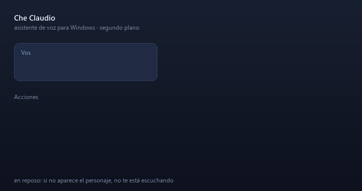

# Che Claudio

> Asistente de voz para Windows: escucha el micrófono y, cuando la frase empieza con **"Che Claudio"**, hace lo que le pedís en segundo plano.
> Abre programas y sitios, maneja Spotify y YouTube, manda WhatsApp, agenda recordatorios, levanta tus proyectos y responde preguntas.
> Las órdenes directas las resuelven reglas (al instante y gratis); lo ambiguo o conversacional lo piensa Claude, el "cerebro".
> Voz a texto (faster-whisper) y respuestas habladas (Piper) corren en tu PC; un personaje en pantalla muestra si escucha, piensa o habla.
> *English: a hands-free voice assistant for Windows in Python (rules + Claude, local speech-to-text and TTS). Docs are in Rioplatense Spanish.*



<sub>Animación generada con el mismo código de dibujo del personaje (`docs/hacer_demo.py`); no es una grabación de pantalla.</sub>

## Quickstart

Requisitos: Windows 10/11 y Python 3.10 o superior.

```bat
git clone https://github.com/JoaquinArg255/CheClaudio.git
cd CheClaudio
scripts\instalar.bat          :: crea .venv e instala las dependencias
copy config.example.json config.json
copy memoria\sobre_mi.example.md memoria\sobre_mi.md
scripts\conectar_claude.bat   :: una vez: inicia sesión en Claude para el cerebro
scripts\iniciar.bat           :: y decí "Che Claudio, ..."
```

`config.json` y `memoria/sobre_mi.md` son tuyos y están fuera del repo (`.gitignore`).
`config.example.json` tiene todos los valores por defecto: en `config.json` alcanza con poner lo que
quieras cambiar. Las voces de Piper se descargan solas la primera vez.

**Contenido:** [Qué hace](#qué-hace) · [Uso](#uso) · [Cuándo te escucha](#cuándo-te-escucha) ·
[Cómo piensa](#cómo-piensa-reglas--cerebro) · [Memoria](#memoria) · [Qué entiende](#qué-entiende) ·
[Privacidad](#privacidad) · [Configuración](#configuración-configjson) · [Si algo no anda](#si-algo-no-anda) ·
[Cómo está armado](#cómo-está-armado)

## Lo más interesante, técnicamente

- **Híbrido de reglas + LLM.** Las órdenes directas ("abrí YouTube", "volumen al 50") las resuelve un
  intérprete de reglas, instantáneo y gratis. Solo lo ambiguo o conversacional va al cerebro (Claude
  vía Agent SDK), con herramientas propias y sin acceso directo a la PC. Ver
  [`interprete.py`](che_claudio/interprete.py) y [`cerebro.py`](che_claudio/cerebro.py).
- **Todo lo de voz corre local.** Transcripción con faster-whisper (GPU NVIDIA si hay, CPU si no) y
  síntesis con Piper. No sale audio de la PC; al cerebro solo le llega texto: lo que empieza con el
  nombre del asistente y lo que se dice en los segundos que sigue atento después de responder.
- **Activación por nombre.** El audio se recorta por silencio, se transcribe y solo se actúa sobre lo
  que empieza con "Che Claudio" (o sigue dentro de una ventana de atención). Lo demás se descarta.
- **Interfaz sin tomar el foco.** El personaje es una ventana Win32 en capas y transparente, dibujada
  con Pillow y manejada con `ctypes`; no roba el foco ni los clics mientras trabajás. Los programas se
  abren en segundo plano, sin taparte lo que estás haciendo ([`sistema/`](che_claudio/sistema)).
- **Intérprete puro y con tests.** El texto→acciones no ejecuta nada, así que se prueba sin tocar el
  sistema: `python -m unittest`.
- **Memoria persistente** en archivos `.md` que el usuario puede leer y editar, con repaso de charlas
  para extraer recuerdos.

## Qué hace

Asistente de voz para Windows. Queda escuchando el micrófono y, cuando una frase empieza con
**"Che Claudio"**, hace lo que le pedís **en segundo plano**, sin sacarte de lo que estás usando.
Aparece un personaje abajo a la derecha que escucha, piensa y te contesta con voz y subtítulos.

> "Che Claudio, abrí Spotify y poné Don't Speak"
> "Che Claudio, tengo ganas de hacer unas cuentas" → "¿Querés que te abra la calculadora?" → "Sí, dale"
> "Che Claudio, mirá mi pantalla y decime qué opinás"
> "Che Claudio, es hora de estudiar, cerrá todo lo demás"

Si querés ver lo que abrió, terminá la orden con **"y mostrámelo"**.

## Uso

| Archivo | Qué hace |
| --- | --- |
| `scripts\iniciar.bat` | Lo inicia con una ventana donde se ve lo que entiende. |
| `scripts\iniciar_oculto.vbs` | Lo inicia sin ventana; lo que hace queda en `datos\che_claudio.log`. |
| `scripts\detener.bat` | Lo apaga cuando corre oculto (o decí "Che Claudio, chau"). |
| `scripts\conectar_claude.bat` | Una sola vez: inicia sesión en Claude para que pueda conversar (ver "El cerebro"). |
| `scripts\vincular_whatsapp.bat` | Una sola vez, para poder mandar mensajes (ver "WhatsApp"). |
| `scripts\instalar.bat` | Solo para otra PC o si se borra `.venv`: instala todo de cero. |

Para que arranque con Windows: `Win + R`, escribí `shell:startup` y poné ahí un acceso directo a
`scripts\iniciar_oculto.vbs`.

## Cuándo te escucha

El personaje en pantalla es la señal: **si está, te está escuchando; si no está, no**.

- Aparece apenas decís "Che Claudio", mientras todavía estás hablando.
- Si lo llamás solo ("Che Claudio") contesta "¿Sí?" y te espera 7 segundos: lo que digas ahí es
  para él, sin repetir el nombre. Lo mismo cuando te hace una pregunta (`segundos_para_contestar`).
- Después de cada respuesta se queda 2,5 segundos con la antena encendida. Si empezás a hablarle en
  ese rato, no hace falta repetir "Che Claudio". Cada vez que le hablás, el tiempo se renueva.
- Si en ese rato decís algo que no es para él, lo deja pasar. Lo que no se deshace (cerrar programas,
  apagar o bloquear la compu, "chau") solo lo hace si lo llamás por el nombre: en ese rato puede ser una
  charla con otra persona o la tele.
- Cuando se va, deja de escuchar hasta que lo vuelvas a llamar.
- Si hacés una pausa en el medio de la frase ("Che Claudio, poneme... Don't Speak"), espera hasta 4
  segundos a que la termines antes de hacer nada.

El tiempo se cambia con `segundos_atento` en `config.json`.

**Si te entiende mal siempre la misma palabra**, en `config.json` hay dos listas: `vocabulario`
(nombres que decís seguido: canales, equipos, juegos; lo ayudan a escribirlos bien) y `correcciones`
(`"lo que entiende": "lo que dijiste"`, por ejemplo `"beric": "break"`).

## Cómo piensa: reglas + cerebro

Las órdenes directas ("abrí YouTube", "pausá", "volumen al 50") las resuelven **reglas**: al
instante y sin gastar nada. Todo lo demás va al **cerebro**, que es Claude (Haiku 5.5) usando la
sesión de tu plan de Claude:

- Conversa y entiende intenciones: "tengo ganas de jugar al Total War" → te ofrece abrirlo.
- Hace varias cosas de un pedido: "cerrá Spotify y seguí con lo de YouTube".
- **Averigua en internet y te contesta él**: "¿qué clima va a hacer mañana?", "¿cómo salió
  Belgrano?". No abre el navegador para eso (tarda unos 7 segundos; se apaga con
  `cerebro.buscar_en_internet` en `false`).
- Elige música cuando no decís cuál: "poné algo", "lo que vos quieras", "algo para estudiar".
- Si no entendió, te lo dice. Si es algo que todavía no sabe hacer, te lo dice y lo anota en
  `Documentos\Notas de Claudio\Cosas que Claudio todavía no sabe hacer.txt` (si se olvida de
  anotarlo, queda anotado igual).
- Sabe lo que hay en tu memoria (ver abajo), va aprendiendo de lo que le contás y lo usa después.
- Puede mirar tu pantalla cuando se lo pedís ("¿qué opinás de esto?").
- Se entera de las órdenes que resolvieron las reglas, así sigue el hilo.

Claude no tiene acceso libre a la PC: solo puede usar las mismas acciones que las reglas (abrir,
música, archivos, WhatsApp, cerrar programas, volumen, proyectos, apagar, mirar la pantalla y
recordar) más la búsqueda web. Lo que ve en pantalla o lee en internet lo trata como información,
nunca como órdenes: en una respuesta donde miró la pantalla o buscó en internet no puede ejecutar
nada ni guardar recuerdos.

Responde sin "pensar antes" (`cerebro.razonar` en `false`): así tarda entre 1 y 3 segundos en lugar
de 4 o 5. Si notás que se equivoca en pedidos complicados, ponelo en `true`.

**Primera vez:** ejecutá `scripts\conectar_claude.bat`, entrá con tu cuenta en el navegador y listo. Usa tu
plan (Pro), no una API paga aparte; cada respuesta consume un poco del cupo del plan. Anthropic
anunció en 2026 que este uso programático podría pasar a un crédito mensual separado y después lo
pospuso: si cambia, puede que deje de ser "sin costo extra".

**Consumo:** cada respuesta del cerebro queda en el registro ("Cerebro: 2,2 s, 5.639 tokens
leídos...") y el total del día en `datos\consumo.json`; también podés preguntarle "¿cuánto consumiste
hoy?". Como referencia, con Haiku una respuesta lee entre 4 mil y 12 mil tokens (casi todos de
caché) y escribe entre 150 y 600, lo que por la API costaría entre 0,2 y 1 centavo de dólar. En el
plan Pro no se cobra: se descuenta del cupo, que ves en claude.ai > Configuración > Uso. Las órdenes
que resuelven las reglas no consumen nada.

Sin sesión (o con `"cerebro": {"activo": false}`), Claudio funciona solo con reglas.

## Memoria

En la carpeta `memoria/` hay archivos de texto que Claudio lee al empezar cada charla:

- `sobre_mi.md`: completalo vos (nombre, cumpleaños, gustos, rutinas como "cuando digo que es hora
  de estudiar, cerrá todo y abrí tal cosa"). Podés crear más archivos `.md`. Lo que esté entre
  `<!--` y `-->` Claudio no lo lee (ahí están los ejemplos).
- `recuerdos.md`: lo escribe Claudio solo, cuando le contás algo de vos (de qué equipo sos, qué
  estudiás, qué te gusta) o le decís "acordate de que...". Podés corregirlo o borrarle líneas.
- `charlas.md`: las últimas 80 cosas que hablaron con el cerebro, para retomar el hilo otro día
  ("¿te acordás del partido que te conté?").

**Repaso:** cada vez que arranca, si desde la última vez hubo seis charlas nuevas o más, las relee
una vez y pasa a `recuerdos.md` lo que valga la pena (dónde vivís, qué mirás, a quién nombrás). Así
aprende aunque en el momento no haya guardado nada. No guarda pedidos sueltos ni cargadas, y no usa
lo que leyó de tu pantalla o de internet. Es una consulta más al cerebro por arranque.

Los cambios a mano se toman en la próxima charla (después de 20 minutos sin hablarle, o al
reiniciarlo).

## Qué entiende

| Para | Ejemplos |
| --- | --- |
| Abrir sitios y programas | "abrí YouTube", "abrí la calculadora y Discord", "abrí Steam y mostrámelo", "abrime una pestaña de Brave", "abrí la configuración de Bluetooth" |
| Poner música en Spotify | "poné Don't Speak", "poné algo de Soda Stereo", "poné algo lindo" (elige el cerebro) |
| Ver un video de YouTube | "poné el video de tal cosa", "abrime el primer video de desafío de Farfadox" (abre directo el primer resultado) |
| Buscar y abrir archivos | "buscá en la carpeta Seminario el PDF del enunciado y abrilo en Brave", "abrí la carpeta descargas" |
| Mandar un WhatsApp | "mandá un hola a mi grupo llamado Tortugas", "decile a Martín que llego en diez minutos" |
| Buscar en la web | "buscá recetas de empanadas", "buscá teclados mecánicos en Mercado Libre" |
| Controlar lo que suena | "pausá", "seguí", "siguiente", "anterior", "cambiá la música"; también por lugar: "ponele pausa al video de YouTube", "cambiame la música de Spotify" |
| Volumen de la PC | "subí el volumen", "bajá un poco el volumen", "volumen al 50", "silenciá" |
| Volumen solo de Spotify | "subile un poquito a Spotify", "poné el volumen de Spotify al 30" (el resto de la PC queda igual) |
| Volumen de Claudio | "hablá más bajo", "subí tu voz", "bajate el volumen a 30" (solo su voz; queda guardado) |
| Cerrar | "cerrá Spotify", "cerrá todo", "cerrá todo menos Spotify y Brave" |
| Recordatorios | "avisame a las 6 y 21 que tengo que salir", "recordame en 10 minutos que saque la pizza", "recordame que mañana a las 9 tengo dentista", "¿qué recordatorios tengo?", "cancelá el recordatorio de la pizza" |
| Notas | "abrí un bloc de notas y escribí: comprar pan y yerba", "anotá que el parcial es el 15", "escribí también que llame a mamá", "escribí en una nota tres ideas para el proyecto" (eso lo escribe Claudio) |
| Preguntas y charla | "qué hora es", "qué sabés de mí", "acordate de que...", "mirá mi pantalla", "¿cuánto consumiste hoy?", "¿qué clima va a hacer mañana?" |
| Programas chicos | "haceme un programa que me pida dos números y los sume", "haceme una página con un cronómetro" |
| Proyectos | "levantá mi proyecto", "levantame el proyecto de mi proyecto para ver el front", "bajá el proyecto mi proyecto" |
| Sistema | "bloqueá la compu", "apagá la compu", "reiniciá la compu", "suspendé la compu", "cancelá el apagado", "chau" (apaga el asistente) |

Con el cerebro conectado no hace falta usar estas frases exactas: decilo como te salga.

### Segundo plano

Todo se abre sin quitarte el foco: los programas quedan minimizados, las páginas van a una pestaña
del navegador sin traerlo al frente, y Spotify se maneja sin tocar su ventana. Para verlo:
"...y mostrámelo", "mostrame YouTube", "abrilo en pantalla", "traeme la ventana de WhatsApp",
"quiero verlo". Esto vale también para el cerebro: si no dijiste nada de verlo, va en segundo plano y
te avisa que quedó minimizado; si le contestás "sí", "dale" o "lo quiero ver", lo trae.

- **Lo que ya está abierto es la excepción**: "abrí Brave" con Brave ya abierto no puede abrir nada
  nuevo, así que trae su ventana al frente (lo mismo con cualquier programa, y con "abrime una
  pestaña de Brave"). Si lo querés igual atrás, decí "en segundo plano". Para que nunca traiga nada
  solo, poné `traer_lo_ya_abierto` en `false` en `config.json`.
- Las páginas se abren como **pestaña nueva en la ventana de Brave que ya tenés**. Si en ese
  momento estás usando Brave, la pestaña nueva queda adelante.
- Un video de YouTube abierto en segundo plano **no arranca hasta que mirás la pestaña** (lo
  decide el navegador). Para música usá Spotify, o pedí "y mostrámelo".

### Recordatorios

Avisa en voz alta (con un sonido antes) a la hora pedida. "A las 6" dicho a la tarde es a las
18; "mañana a las 8 de la noche" también se entiende. Con el cerebro podés pedir una serie entera:
"voy a estudiar con Pomodoro, cuatro bloques de 25 con descansos de 5" agenda todos los avisos. Quedan guardados en `datos\recordatorios.json`: si
el asistente estaba apagado cuando tocaba, avisa al arrancar (hasta 12 horas tarde).

### Notas

Cada nota es un archivo en `Documentos\Notas de Claudio` y se abre en el Bloc de notas, minimizado
salvo que digas "y mostrámelo". "Escribí también...", "anotá..." o "agregá a la lista..." suman a la
última nota si es de la última media hora; si no, empieza otra. Claudio nunca escribe en pestañas
que ya tenías abiertas: solo en sus propias notas.

### Cerrar todo

"Cerrá todo" cierra las ventanas de programas como si apretaras la X: los que tienen cambios sin
guardar te preguntan antes. Nunca cierra el escritorio ni las consolas (por si Claudio corre en
una), ni lo que esté en `no_cerrar` de `config.json` (de entrada, la app de Claude).

### Proyectos

"Levantá mi proyecto" arranca los servicios del proyecto, espera a que respondan y abre su página.
Tarda (un backend puede demorar un minuto): Claudio dice que lo está levantando y **avisa solo
cuando queda listo**, o cuál paso falló. "Bajá el proyecto mi proyecto" cierra lo que él arrancó;
lo que hayas levantado vos por tu cuenta no lo toca.

Cada proyecto se define en `config.json`, dentro de `proyectos`:

```json
"mi proyecto": {
  "carpeta": "C:\\Users\\TuUsuario\\Desktop\\MiProyecto",
  "pasos": [
    { "nombre": "base de datos", "comando": "docker compose up -d", "carpeta": "Backend", "esperar": true },
    { "nombre": "backend", "comando": "mvnw.cmd spring-boot:run", "carpeta": "Backend", "puerto": 8080 },
    { "nombre": "frontend", "comando": "npm run dev", "carpeta": "Frontend\\Frontend", "puerto": 5173 }
  ],
  "abrir": "http://localhost:5173"
}
```

- `esperar`: el paso tiene que terminar antes de seguir (levantar la base). Sin eso, queda corriendo.
- `puerto`: si ya responde, ese paso se saltea; si no, se espera a que responda (hasta 4 minutos).
- `al_bajar` (opcional): un comando para correr al bajar, por ejemplo `"docker compose stop"`.

Los pasos corren ocultos, sin ventana. Lo que imprimen queda en `datos\proyectos\<proyecto>\<paso>.log`:
ahí se ve por qué falló uno. Para la base hace falta que Docker Desktop esté abierto.

### Programas chicos

"Haceme un programa que..." se lo encarga a otro Claude (Sonnet, que programa mejor que Haiku), que
tarda un minuto o dos. Claudio avisa cuando termina y deja abierta, minimizada, la carpeta
`Documentos\Programas de Claudio\<nombre>` con el código y un `LEEME.txt` que dice cómo usarlo.
Solo puede crear archivos dentro de esa carpeta y no ejecuta nada: el programa lo abrís vos. Gasta
bastante más cupo que una respuesta común (el modelo se cambia con `cerebro.modelo_para_programar`).

### Apagar la computadora

"Apagá la compu", "reiniciá la compu" y "suspendé la compu" **siempre preguntan antes** ("¿Seguro
que apago la computadora?") y esperan tu "sí". El apagado arranca un minuto después, para que
guardes lo que tengas abierto; en ese minuto, "Che Claudio, cancelá el apagado" lo frena.
"Che Claudio, apagate" es otra cosa: cierra a Claudio, no la PC.

### Archivos

Busca por nombre aproximado en tu carpeta de usuario, así que no hace falta decir el nombre exacto:
"resumen parcial uno" encuentra `Ingeniería de Software resumen parcial 1.pdf`. Si hay varios
parecidos elige el que mejor coincide y, a igualdad, el más reciente; te dice cuál abrió. Nunca
abre archivos que se ejecutan (`.exe`, `.bat`, `.lnk`, `.ps1`...): una descarga llamada
`factura.pdf.exe` no se confunde con una factura. Los programas se abren con "abrí <programa>".

### WhatsApp

Los mensajes salen por WhatsApp Web en un navegador **oculto** (Edge sin ventana, con un perfil
propio guardado en `datos\perfil_whatsapp\`). No toca tu app de WhatsApp ni tu navegador.

1. Una sola vez: `scripts\vincular_whatsapp.bat`, y escaneá el QR desde el teléfono (WhatsApp >
   Dispositivos vinculados > Vincular un dispositivo).
2. Para comprobar que encuentra un chat sin mandar nada:
   `scripts\iniciar.bat --simular --texto "mandá un hola a mi grupo llamado Tortugas"`.
3. Al pedir un mensaje, Claudio busca el chat y **pregunta antes de enviar**: "¿Le mando Hola a
   Tortugas?". Respondé "sí" o "no". Si no contestás en 10 segundos, no manda nada.

Mientras no esté vinculado, Claudio lo dice al instante (no vuelve a abrir el navegador oculto para
comprobarlo cada vez). Al vincular con `scripts\vincular_whatsapp.bat` empieza a funcionar solo.

Es una automatización no oficial de WhatsApp Web: para unos pocos mensajes personales no suele traer
problemas, pero WhatsApp no la avala. `datos\perfil_whatsapp\` contiene tu sesión: no la compartas.

## Privacidad

- El reconocimiento de voz (Whisper) y la voz con la que responde (Piper) corren en tu PC.
- Lo que no empieza con "Che Claudio" no se guarda ni se manda a ningún lado, salvo en los segundos
  que sigue atento: 2,5 s después de cada respuesta (`segundos_atento`) y 7 s cuando te hizo una
  pregunta o te contestó "¿Sí?" (`segundos_para_contestar`). Ahí lo que las reglas no entienden va al
  cerebro para que decida si era para él; si no lo era, no se guarda. Con los dos en 0 solo escucha lo
  que empieza con su nombre, pero para contestarle una pregunta vas a tener que nombrarlo.
- Al cerebro (Claude, de Anthropic) le llega lo que le decís, tu memoria y, solo cuando se lo
  pedís, una captura de la pantalla. Cuando busca algo en internet, la búsqueda sale desde Claude.

## Configuración (`config.json`)

Los valores por defecto están en `config.example.json`; en tu `config.json` poné solo lo que cambies.
Los sitios, apps, correcciones y proyectos que agregues se suman a los del ejemplo.

| Clave | Para qué |
| --- | --- |
| `nombres` | Cómo se llama el asistente. `["claudio", "jarvis"]` responde a los dos. |
| `modelo` | Reconocimiento de voz. `auto` usa `large-v3-turbo` con placa NVIDIA y `small` sin ella. |
| `dispositivo` | `auto` usa la placa NVIDIA si están las librerías; `cpu` la evita. |
| `microfono` | `null` usa el predeterminado de Windows. Si no, parte del nombre (`"H510"`) o el número que muestra `scripts\iniciar.bat --dispositivos`. |
| `umbral_microfono` | Volumen mínimo para considerar que alguien habla. |
| `vocabulario` | Nombres que decís seguido (canales, equipos, juegos, programas): lo ayudan a escribirlos bien. |
| `correcciones` | `"lo que entiende mal": "lo que dijiste"`. Se aplica a todo lo que escucha. |
| `responder_con_voz` | Respuestas habladas. |
| `voz` | Voz neuronal de Piper. `es_AR-daniela-high` (argentina) por defecto; otras: `es_MX-claude-high`, `es_ES-davefx-medium` (masculina), `es_MX-ald-medium` (masculina). Se descarga sola al cambiarla. |
| `volumen_voz` | Qué tan fuerte habla Claudio, de 0 a 1 (`0.35` = 35%). No toca el volumen de la PC. Si se lo cambiás hablando, queda en `datos\preferencias.json`, que tiene prioridad. |
| `segundo_plano` | `true`: todo en segundo plano salvo "y mostrámelo". |
| `traer_lo_ya_abierto` | `true`: pedir que abra algo que ya está abierto lo trae al frente. `false`: lo deja donde está. |
| `segundos_atento` | Cuánto se queda en pantalla escuchando después de cada respuesta (2,5). |
| `segundos_para_contestar` | Cuánto espera tu respuesta después de un "¿Sí?" o de una pregunta suya (7). |
| `confirmar_mensajes` | Preguntar antes de mandar un WhatsApp. |
| `reproductor` | `spotify` o `youtube`: dónde va "poné X" cuando no se aclara. |
| `musica_a_gusto` | Qué poner con "poné algo" cuando el cerebro está apagado (por ejemplo `"lofi"`). Con el cerebro, elige él. |
| `cerebro.activo` | Usar a Claude cuando las reglas no alcanzan. |
| `cerebro.razonar` | `false`: responde directo (1 a 3 s). `true`: piensa antes de responder (4 a 5 s, algo más de cupo). |
| `cerebro.buscar_en_internet` | `true`: puede averiguar datos actuales y contestarlos él. |
| `cerebro.modelo` / `cerebro.esfuerzo` | Qué modelo usa: `claude-haiku-5-5` con esfuerzo `"low"` (en las pruebas, 1,6 a 2,5 s por respuesta contra 2,2 a 3,5 s de Haiku 4.5, y entiende mejor lo mal escuchado). Para volver: `claude-haiku-4-5` con el esfuerzo en `null` (ese no lo acepta). Alternativa: `claude-sonnet-5-5` con `"low"`, que en las pruebas respondió más rápido (unos 2,7 s contra 4,1 s) pero gasta más cupo por respuesta. |
| `cerebro.modo` | `hibrido`: reglas primero. `siempre`: todo pasa por Claude (más natural, más lento, gasta más cupo). |
| `avisar_consultas` | Claudio avisa en voz alta cuando Claude Code termina una consulta que tardó más de `segundos_minimos` (240, o sea 4 minutos), y siempre que Claude te pregunta algo o necesita tu permiso, diciendo en qué carpeta y qué pregunta ("Claude te está preguntando algo en CheClaudio: ¿...?"). Usa los hooks de `scripts/avisar_claude.py`. `activo` en `false` lo apaga. |
| `avatar.activo` / `avatar.escala` | El personaje en pantalla y su tamaño (`1.5` = 50% más grande). |
| `no_cerrar` | Programas que "cerrá todo" no toca. |
| `sitios` / `apps` | Nombres hablados y qué abre cada uno. |
| `proyectos` | Proyectos de programación que sabe levantar y bajar (ver "Proyectos"). |

Los cambios se toman al reiniciar el asistente.

## Si algo no anda

- **No reacciona cuando hablo.** `scripts\iniciar.bat --nivel` muestra el volumen del micrófono: al hablar
  tiene que superar `umbral_microfono`.
- **Entiende otra cosa.** `scripts\iniciar.bat --detalle` muestra todo lo que escucha.
- **Probar sin hablar.** `scripts\iniciar.bat --texto "tengo ganas de hacer unas cuentas"`. Si Claudio
  pregunta algo, contestale en la misma ventana. Con `--sin-cerebro` usa solo reglas; con
  `--simular` solo muestra qué haría.
- **Dice que no inició sesión en Claude.** Ejecutá `scripts\conectar_claude.bat`.
- **La placa de video se queda sin memoria con un juego.** Poné `"modelo": "small"`.
- **WhatsApp dice que no está vinculado.** Corré `scripts\vincular_whatsapp.bat` de nuevo.
- **Un proyecto no levanta.** Mirá `datos\proyectos\<proyecto>\<paso>.log`; para la base, que Docker
  Desktop esté abierto.
- **Entiende mal siempre la misma palabra.** Sumala a `vocabulario` o a `correcciones`.

## Cómo está armado

```
che_claudio/
  __main__.py      línea de comandos: arma las piezas y arranca
  asistente.py     bucle de escucha, ventana de atención y quién resuelve cada orden
  interprete.py    texto -> acciones por reglas (no ejecuta nada; tiene tests)
  tiempo.py        horas y fechas como se dicen: "en media hora", "son las 9 y media"
  cerebro.py       Claude por el Agent SDK, con herramientas propias y nada más
  acciones.py      ejecuta cada acción (la usan las reglas y el cerebro)
  config.py        config.json, preferencias y rutas (RAIZ, DATOS)
  texto.py         normalización y parecido entre palabras
  memoria.py       lectura de memoria/, recuerdos nuevos y repaso de charlas
  recordatorios.py avisos a una hora, guardados en datos/recordatorios.json
  notas.py         notas propias en el Bloc de notas
  proyectos.py     levanta y baja proyectos de programación definidos en config.json
  programador.py   encarga programas chicos a Claude
  avatar.py        el personaje: ventana transparente que no toma el foco
  voz/
    microfono.py   micrófono y recorte de frases por silencio
    transcriptor.py voz a texto (faster-whisper)
    habla.py       respuestas habladas (Piper) y movimiento de la boca
  sistema/
    ventanas.py    foco, ventanas y teclas (Win32)
    lanzador.py    abre programas, páginas y archivos sin sacar el foco
    multimedia.py  pausa / siguiente / anterior sobre lo que suene en Windows
    pantalla.py    captura para que el cerebro mire
    catalogo.py    nombres -> sitios, apps configuradas o apps instaladas
    archivos.py    búsqueda de archivos y carpetas por nombre aproximado
  servicios/
    spotify.py     búsqueda y reproducción con la CLI de Spotify
    whatsapp.py    WhatsApp Web en un navegador oculto
    youtube.py     primer video de una búsqueda
scripts/           iniciar, detener, instalar, vincular WhatsApp, conectar Claude y el aviso para Claude Code
tests/             python -m unittest
docs/              la demo y el script que la genera
memoria/           lo que Claudio sabe de vos (personal: fuera del repo, salvo el ejemplo)
datos/             todo lo que se genera al usarlo (fuera del repo)
```
